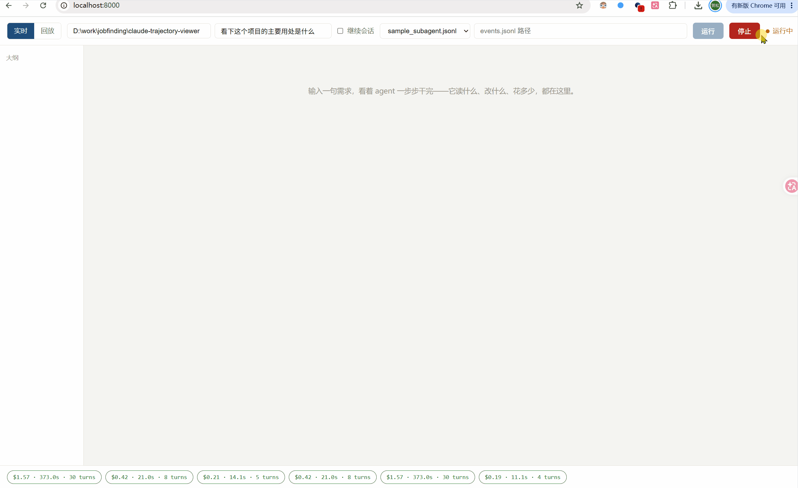

# claude-trajectory-viewer

一个本地 Web 工具：驱动 Claude Code 以 headless 模式运行，实时可视化 agent 的每一步——它读了哪个文件、跑了哪条命令、改了什么、花了多少钱。

> agent 可观测性工具：**"你优化不了你看不到的东西。"**



## 功能

- **实时轨迹**：事件到达即渲染（不是跑完才出结果），assistant 文本按 markdown 渲染
- **工具调用配对**：`tool_use` 卡片先 ⏳ pending，结果到达后按 `tool_use_id` 配对 → ✓/✕，报错红框
- **长输出折叠**：超 400 字自动折叠，点击展开/收起
- **树形轨迹**：subagent 事件嵌到触发它的 `Task` 卡片下、可折叠，侧边大纲可跳转
- **成本可见**：每轮展示 cost / 耗时 / 轮数
- **续接会话**：勾选「继续会话」用 `session_id` 续跑，保留上一轮上下文
- **replay 模式**：回放已保存的 `events.jsonl`，免费瞬时开发
- **噪音过滤**：后端过滤掉约 99% 的 `thinking_tokens` 噪音事件

## 快速开始

**前置条件**：本机已安装 Claude Code CLI，且**登录过一次**（运行 `claude` 完成登录，或 `claude /login`）。工具走 `claude -p` headless 模式，直接读本地缓存的凭证，**无需保持交互式会话打开**；若从未登录，点 Run 会显示"未登录"报错（而不是一直转圈）。

```bash
pip install -r requirements.txt
python server.py          # 浏览器打开 http://localhost:8000
```

依赖仅 `fastapi` + `uvicorn`，无需其他服务或数据库。

## 二进制版（免装 Python）

`dist/` 下已提供两个单文件二进制，双击/运行即用，无需 Python、无需 pip：

| 平台 | 文件 | 说明 |
|---|---|---|
| Windows | `claude-trajectory-viewer.exe` | 双击即跑 |
| Linux | `claude-trajectory-viewer-linux` | `chmod +x` 后直接跑 |

默认监听 `127.0.0.1:8000`。要改地址/端口，用 `HOST` / `PORT` 环境变量：

**Windows（PowerShell）**
```powershell
$env:PORT = "8080"
.\claude-trajectory-viewer.exe
```

**Windows（写个 `start.bat` 双击）**
```bat
@echo off
set PORT=8080
set HOST=127.0.0.1
claude-trajectory-viewer.exe
```

**Linux（前台）**
```bash
PORT=8080 ./claude-trajectory-viewer-linux
```

**Linux（后台 + 局域网访问）**
```bash
HOST=0.0.0.0 PORT=8080 nohup ./claude-trajectory-viewer-linux > server.log 2>&1 &
```

> ⚠️ 默认只绑 `127.0.0.1`（仅本机可访问）。`HOST=0.0.0.0` 会暴露到网络，而本工具**暂无鉴权**，只在可信网络（如自己的内网/服务器）里这样做。

## 用法

**live 模式**：填工作目录 + prompt，点 Run。后端 spawn `claude -p --output-format stream-json --verbose`，过滤后经 SSE 实时推给浏览器。默认用 `--allowedTools` 精确放行（Read/Edit/Write/Glob/Grep/Bash）。

**replay 模式**：切到 replay，填 `events.jsonl` 路径，离线回放。`replay/` 下有两个样例：
- `sample_subagent.jsonl` —— 合成样例，演示 subagent 树形嵌套
- `sample_real.jsonl` —— 一次真实 run 精简后的轨迹

## 架构

```
浏览器（前端）── SSE ── 后端（FastAPI：spawn claude → 过滤 → 推流）── claude -p
```

后端是**可复用的「agent 事件服务器」**：前端只是第一个客户端。事件 schema 是纯 JSON，将来安卓 app 连同一个后端即可，传输协议可换 SSE/WebSocket。

## 事件 schema

后端只放行 4 类事件，其余（`thinking_tokens`、`hook_*`、`task_*`）一律过滤：

| 事件 | 关键字段 | 用途 |
|---|---|---|
| `system/init` | `session_id` `cwd` `model` | 记录会话 |
| `assistant` | `message.content[]`（text / tool_use） | 文本 + 工具调用 |
| `user` | `message.content[]`（tool_result） | 工具结果，按 `tool_use_id` 配对 |
| `result` | `total_cost_usd` `duration_ms` `num_turns` | 本轮数字 |

## 技术栈

Python 3.10+ · FastAPI · 原生 HTML/CSS/JS（无构建步骤）· marked（CDN，markdown 渲染，失败自动回退纯文本）

## License

MIT
